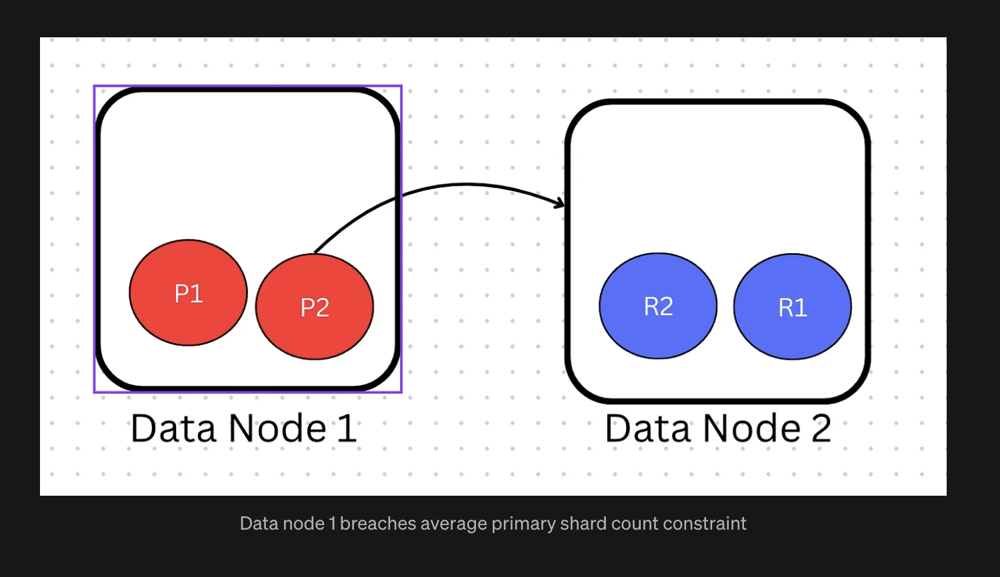

# Preventing hot shards and increasing throughput in OpenSearch

## The problem

The allocator was balancing the wrong thing.

It counted shards per node and called the cluster balanced. That worked when every copy of a shard did roughly the same work. Segment replication ended that assumption.

Before it, the primary indexed each document and sent the document to its replicas, and each replica indexed it again on its own. Work was shared. Every copy cost about the same.

After it, the primary does all the indexing, builds finished Lucene segments, and ships those segments straight to replicas that only receive bytes and serve reads. The primary takes the writes. Replicas copy from the primary. And now the primary costs multiples of a replica in both CPU and network.

So a cluster could show perfectly even shard counts while one node did all the indexing and all the segment shipping. The dashboard said balanced. The nodes said otherwise. Anyone who has run a distributed system knows the word for this: a hotspot. One node sweats while the rest of the cluster watches, and the allocator that manufactured it could not see it.

That gap, between what the allocator measured and what the machines felt, is what I fixed. It shipped in OpenSearch 2.11.

## What I tried first

The allocator scored each node with a weight built from two factors: shards per index on the node, and total shards on the node. Lighter nodes won new shards.

My first approach added a third factor for primaries. Node weight became the sum of all three. It merged. It worked on the common cases. Then it broke in a way I did not expect.

## Why I changed course

Sums hide things. Here is the smallest case that broke it: two nodes, two indices, each index with one primary and one replica. The allocator put both primaries on node 1 and both replicas on node 2. Primary distribution was as bad as it could be. But the summed weights came out nearly equal, so the allocator saw nothing wrong and moved nothing.

A surplus in one factor had cancelled a deficit in another. The signal I cared about, primary balance, had a vote in the average instead of a veto over the outcome.

I reverted the approach two weeks after it merged. That stung, but the lesson stuck: enforce what matters with a constraint. Use weights only for preferences.

## The final design

The replacement is a single rule. No node may hold more primary shards of an index than the average across nodes. Break the rule and the allocator adds a heavy penalty to that node's weight. The node stops winning new shards, and primaries get rebalanced off it.

Two pieces:

- A per-index primary shard constraint, checked on allocation and on rebalance. Breach it and 100k gets added to the node weight. That number is large enough to disqualify the node until it is back under the average.
- A cluster setting, `cluster.routing.allocation.balance.prefer_primary`, defaulting to false. Operators opt in. Existing clusters see no surprise rebalancing.

Walk through a failure to see it work. A data node dies. Its replica gets promoted to primary. Now one node holds both primaries. The dead node comes back. The allocator counts: 2 primaries against an average of 1. Breach. It moves one primary back to the rejoined node, then shifts a replica the other way, because a node cannot hold both copies of one shard. End state: primaries and replicas spread evenly.

## Measured impact

- Shipped in OpenSearch 2.11.
- Turned on by default for the managed service or1 instance family.
- Customer-requested. Covered in OpenSearch blog posts after launch.
- Throughput went up as a side effect. When primaries spread evenly, no single node bottlenecks ingestion, so the cluster indexes faster overall. Fixing the hotspot fixed the throughput.
- The design got real review, including a public thread on whether the constraint approach is optimal for this problem. Good. That is how designs get better.

## What I took with me

Two things. First, the engineering rule: constraints enforce, weights prefer, never mix them. Second, the harder one: I shipped the wrong approach, saw it fail, reverted it in two weeks, and built the better version. Reverting fast is part of the job, not a mark against it.

---

*References: [weight-based PR](https://github.com/opensearch-project/OpenSearch/pull/6017), [revert](https://github.com/opensearch-project/OpenSearch/pull/6439), [constraint-based PR](https://github.com/opensearch-project/OpenSearch/pull/6422), [follow-up](https://github.com/opensearch-project/OpenSearch/pull/6643). Related writing: [Medium article](https://medium.com/@surajrider/primary-data-shard-allocation-in-distributed-storage-system-b99c1ded5296), [LinkedIn post](https://www.linkedin.com/posts/surajsingh-ss_distributedsystems-opensearch-share-7276753220813602817-xaHw/).*
